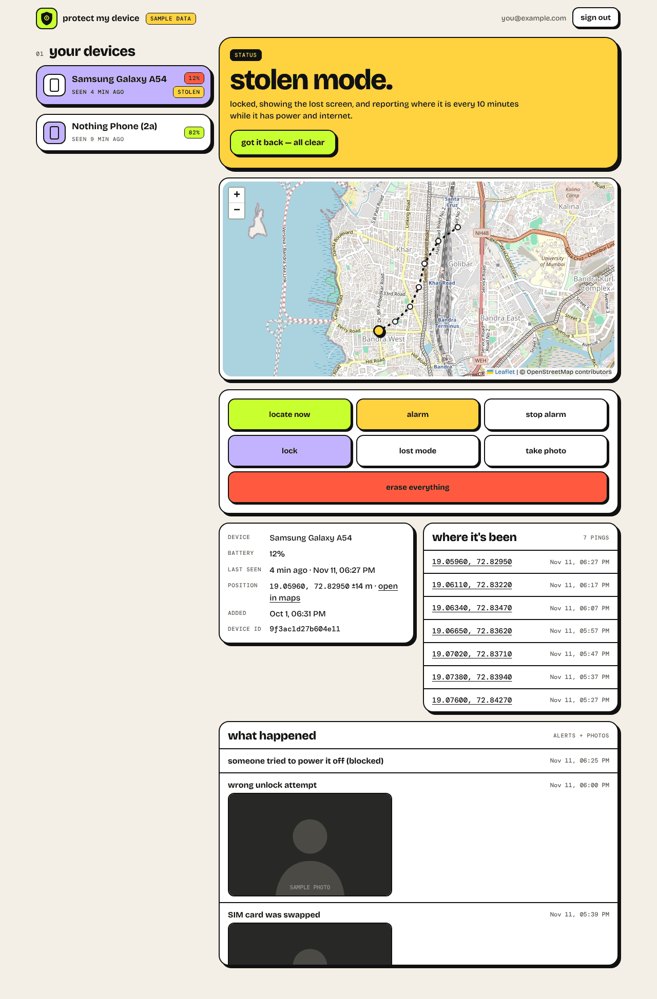
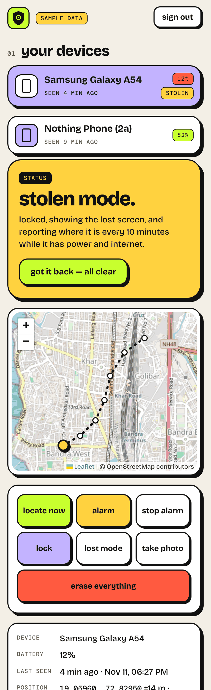
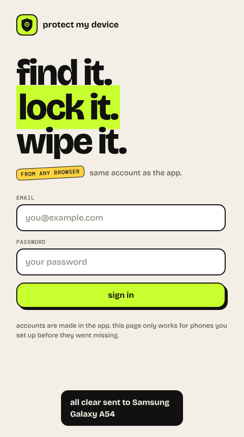
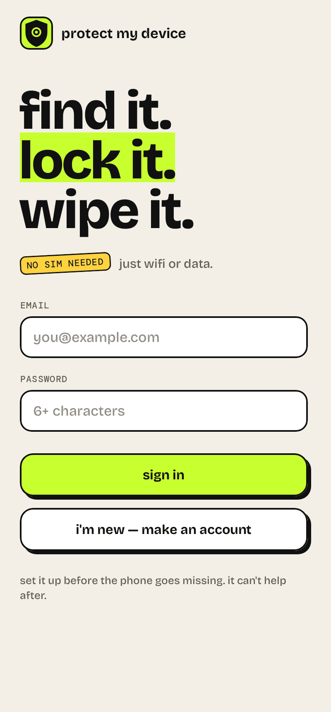
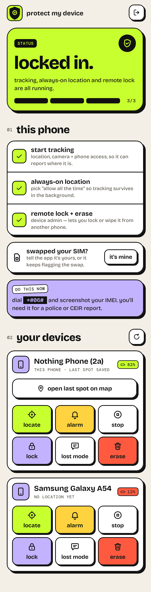
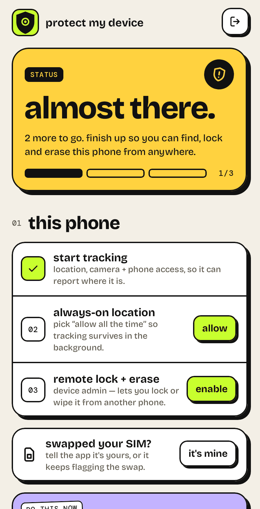
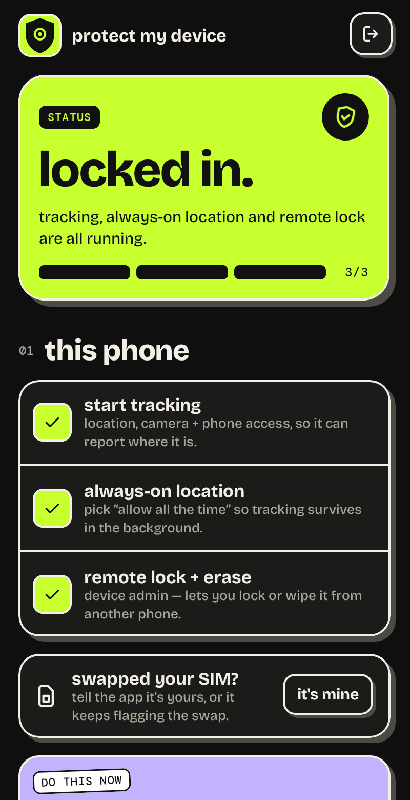
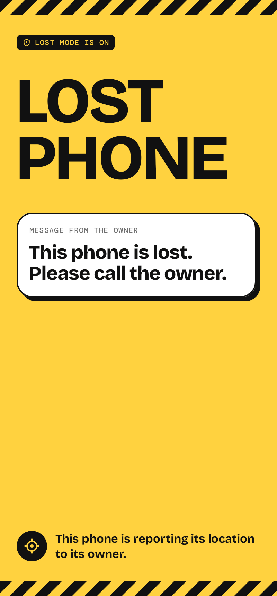

# Protect My Device

Android anti-theft app (Kotlin + Firebase). Tracks, locks, sounds an alarm on, and (if needed) wipes **your own** phone **without needing a SIM or IMEI** — it only needs internet (WiFi or mobile data) and has to be set up *before* the phone is lost.

## Features
- **Live location** (GPS + WiFi) via a foreground service, restarted after reboot. A fix every 15 minutes day to day, every 10 minutes in stolen mode, every 15 seconds for two minutes after "locate".
- **Remote commands** from a second phone or the web dashboard: Locate, Alarm, Lock, Lost-mode message, Take photo, Stolen mode, Erase.
- **Stolen mode**: one button that locks the phone, puts up the lost screen, takes a front-camera photo and reports location every 10 minutes. It survives reboots and stays on until you mark the phone safe.
- **Thief detection**: SIM swap → alert + location + front-camera photo; wrong unlock password → photo.
- **Last-known position**: when the phone is switched off, the battery runs low or airplane mode goes on, it records where it was. If it can't send that right away, it goes out the next time the phone is online.
- **Block power-off (experimental)**: an accessibility service that closes the power menu while the phone is locked. See the limits below.
- **Accounts**: email + password, in the app and on the website. Create an account, sign in, reset a forgotten password; one account covers all your phones.
- **Web dashboard** (`web/`): sign in from any browser to see every phone on the account, its battery, map, location history, alerts and thief photos, and send it commands.
- **Offline finding (BLE)**: rotating-ID beacon + scanner (`ble/`). Coverage depends on nearby app users.

### What it can't do
- **Find a phone that is switched off.** No third-party app can transmit from a powered-down phone. Only Google's Find Hub network can, and only on phones built for it (Pixel 8 and later, and some others). Turn it on in Settings and set it to "With network in all areas"; the app's "extra armour" card links there.
- **Stop a forced shutdown.** The power-off blocker only closes the on-screen power menu. Holding the hardware keys for a forced restart still works, and so does waiting for the battery to die. It also depends on an internal system class name that differs between manufacturers, so test it on your own phone. Sideloaded apps on Android 13+ need "Allow restricted settings" (App info > ⋮) before Accessibility will let you enable it.
- **Report without internet.** Location only reaches you over WiFi or mobile data.

## Setup
Full step-by-step instructions, including the signed release build, App Check and the Play Store, are in **[DEPLOY.md](DEPLOY.md)**. The short version for trying it out:
1. Create a Firebase project; add an Android app `com.protectmydevice`; download `google-services.json` into `app/` (git-ignored).
2. Enable Auth (Email/Password), Firestore, Storage, Cloud Messaging.
3. `firebase deploy --only firestore:rules,storage,functions,hosting`
4. `./gradlew assembleDebug`, install on the phone, then follow the 3 steps on the home screen.

## Security
What a reverse-engineering tool can pull out of the app and the website, and what protects your data anyway, is written up in **[docs/SECURITY.md](docs/SECURITY.md)**. In short: nothing in the client is secret or trusted, access is decided by server-side rules, release builds are obfuscated, and App Check can lock the backend to the genuine app.

## Important notes
- Write down your IMEI (`*#06#`) and file a police complaint + block it via India's CEIR / Sanchar Saathi portal.
- Also keep Google *Find Hub* (Find My Device) / Samsung Find enabled — they work with no SIM.
- Remote wipe is destructive; the UI asks for confirmation in a separate "no undo" dialog.

## Web dashboard
A static site in `web/` with the same look as the app. Sign in with the same account as the app.

| Dashboard | Phone | Sign in |
|---|---|---|
|  |  |  |

1. In the Firebase console add a **Web app** to the project and paste its config into `web/firebase-config.js`.
2. `firebase deploy --only hosting` — the site is then at `https://<project-id>.web.app`.
3. New here? Press "i'm new — make an account" on the sign-in page, or use the account you made in the app.
4. To look around without Firebase, serve `web/` locally and open it with `?demo` for made-up sample data: `python3 -m http.server -d web 8000`, then `http://localhost:8000/?demo`.

Only the account that owns a device can read its data or photos (`firestore.rules`, `storage.rules`). The map uses OpenStreetMap tiles.

## Design
Loud on purpose: flat acid colours, 2dp ink outlines, hard offset shadows that buttons physically drop onto when pressed, lowercase copy. No gradients, no blur.

| Sign in | Home | Setup in progress | Dark | Lost mode |
|---|---|---|---|---|
|  |  |  |  |  |

- **Colour** (`ui/theme/Color.kt`): Ink `#111111`, Paper `#F3EFE6`, Lime `#C8FF2E` (protected / primary action), Hazard `#FFD23F` (needs attention, lost mode), Lilac `#C3B3FF` (info), Coral `#FF5A40` (destructive). Coloured blocks always carry ink text, in light and dark.
- **Type** (`ui/theme/Type.kt`): Bricolage Grotesque for everything you read, DM Mono for tags and numbers. Both are bundled in `res/font` under the SIL Open Font License (`licenses/`).
- **Building blocks** (`ui/components/Brutal.kt`): `BrutalBox`, `BrutalButton`, `BrutalPressable`, `Sticker`, `BrandMark`. Icons are 24dp stroke vectors in `res/drawable`.
- **Screens** (`ui/screens/`) are stateless; `MainActivity` wires them to Firebase and permissions, and `ui/Previews.kt` renders them in Android Studio with sample data.
- The lost-mode screen is deliberately not playful: it is hazard yellow in every theme and addressed to whoever is holding the phone.

## Tests
- **App**: `./gradlew :app:testDebugUnitTest :app:lintDebug`
- **Backend and website** (`tests/`, needs Node 20+ and Java): `cd tests && npm ci && npm test`. This starts the Firebase emulators and runs:
  - `rules.test.js` — who can and cannot read devices, history, alerts and photos, or send commands;
  - `dashboard.test.js` — the real website in a real browser: sign-up, sign-in, password reset, a phone appearing live, every action button, stolen mode, erase confirmation, sign-out;
  - `csp.test.js` — the site still works under its production security headers;
  - `functions.test.js` — Cloud Function logic, and that the app, rules, function and website agree on the command list.
- CI (`.github/workflows/ci.yml`) runs all of the above on every pull request.

Not covered by automation: anything that needs a physical phone (push delivery, camera, device admin, the accessibility service). See the checklist at the end of `DEPLOY.md`.
